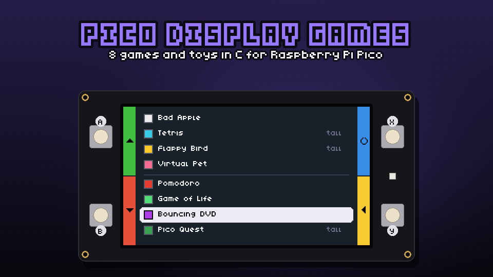
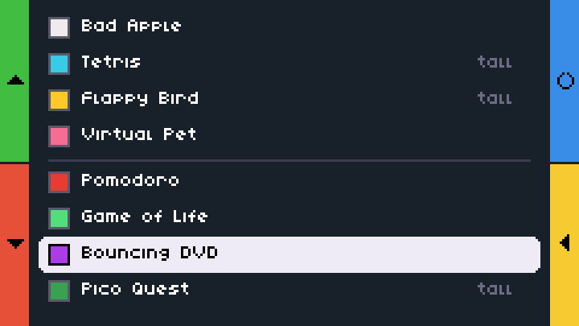
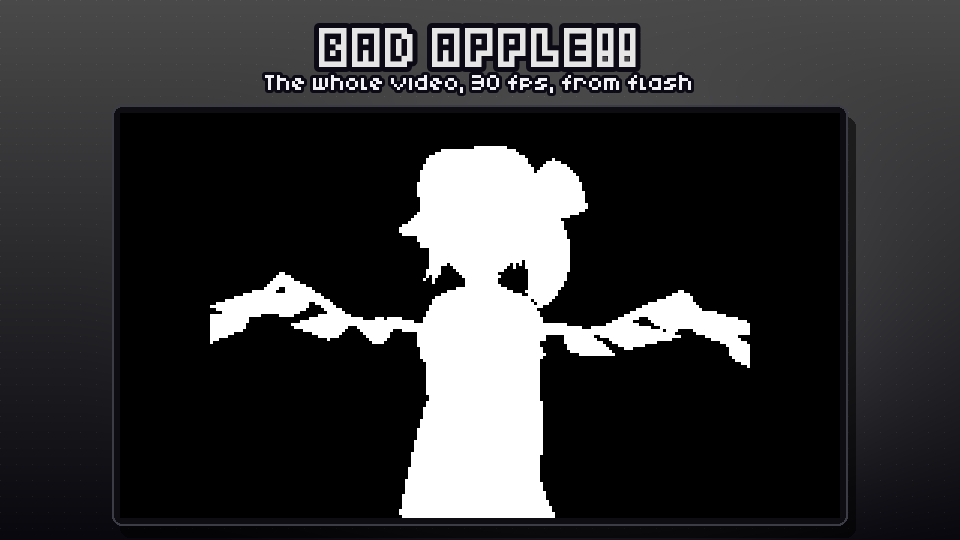
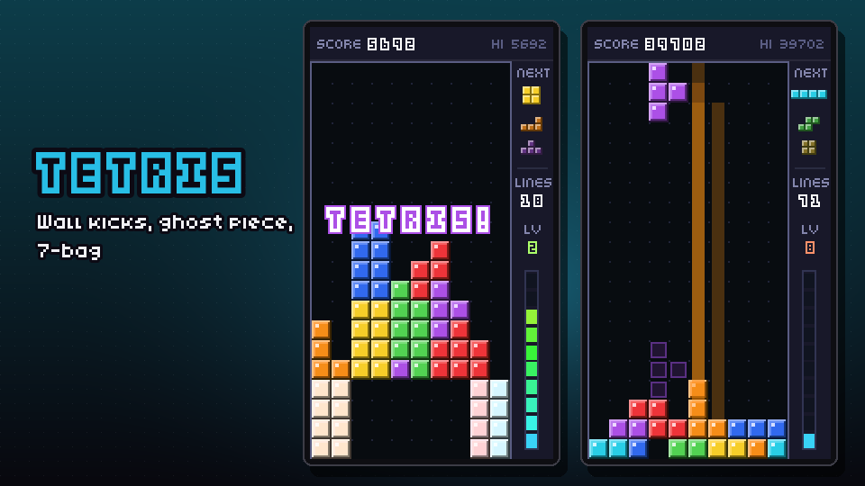
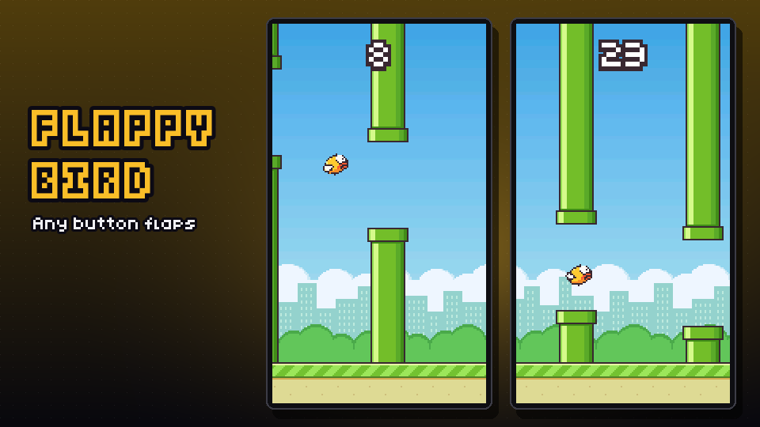
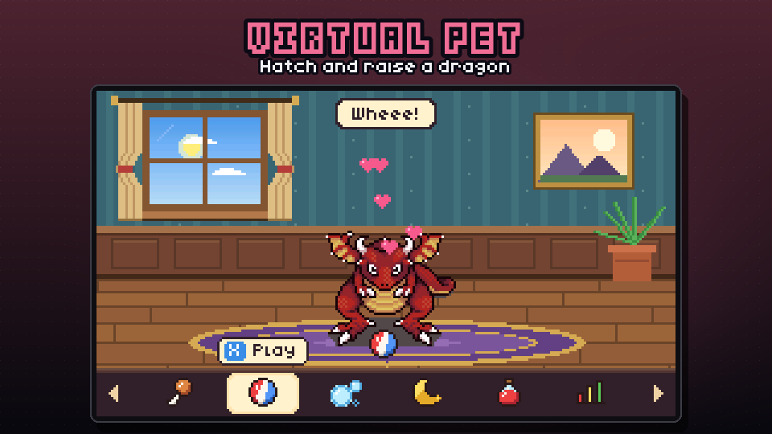
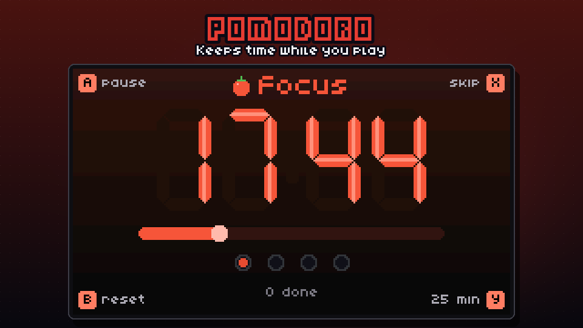
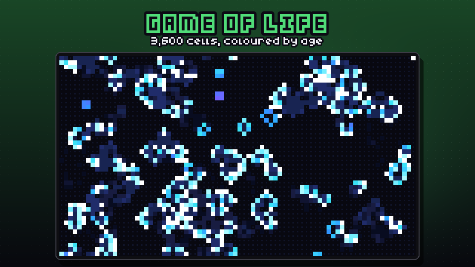
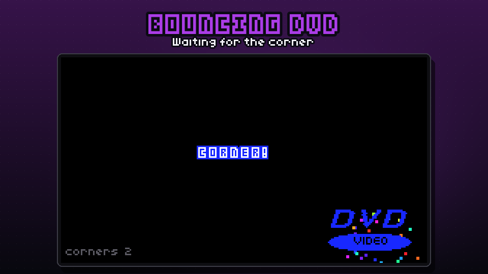
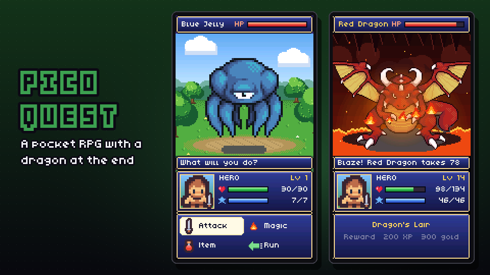

# raspberry-pi-pico-display-games

Games and toys for a Raspberry Pi Pico with Pimoroni's
[Pico Display Pack](https://shop.pimoroni.com/en-us/products/pico-display-pack): a 1.14" 240x135
IPS screen, four buttons and an RGB LED.

There are two versions here. The **C version** in [`c/`](c/) is the current one: eight apps in a
single firmware image with a launcher. The **MicroPython version** (the `.py` files at the top of
the repository) is the original, and is described at the end of this page.

## C version



| App | What it is |
| --- | --- |
| Bad Apple | The shadow-art video at 180x135 and 30 frames a second, in black and white. |
| Tetris | Tetris played upright, with a ghost piece, next-piece preview and levels. |
| Flappy Bird | One button, one bird, a lot of pipes. Played upright. |
| Virtual Pet | Raise a dragon from an egg. It gets hungry even while you play the other apps. |
| Pomodoro | A 25/5 focus timer that keeps running in the background. |
| Game of Life | Conway's Life on an 80x45 wrapping grid, coloured by age. |
| Bouncing DVD | The screensaver. Waiting for the corner is the whole point. |
| Pico Quest | A small Dragon Quest-style RPG, played upright. |

### What you need

- A Raspberry Pi Pico, Pico W, Pico 2 or Pico 2 W, with headers.
- A Pimoroni Pico Display Pack, the 1.14" one.

### Build and flash

You need CMake, Ninja, the [Arm GNU toolchain](https://developer.arm.com/downloads/-/arm-gnu-toolchain-downloads)
(`arm-none-eabi-gcc`) and the [Pico SDK](https://github.com/raspberrypi/pico-sdk) 2.x, with
`PICO_SDK_PATH` pointing at the SDK.

```bash
cd c
cmake -S . -B build-pico -G Ninja -DPICO_BOARD=pico     # or pico_w, pico2, pico2_w
cmake --build build-pico
```

Hold BOOTSEL while plugging the Pico in, then copy `build-pico/pico_display_games.uf2` onto the
`RPI-RP2` (or `RP2350`) drive that appears. The board restarts into the launcher.

On a Mac whose newest command-line SDK breaks the linker (`ld: tapi error: malformed file`), point
the build at an older one with `export SDKROOT=/Library/Developer/CommandLineTools/SDKs/MacOSX26.sdk`.

### Bad Apple's frames

The video is not in this repository, and neither are the frames made from it. Encode your own copy
before building, and the build links the frames in:

```bash
python c/tools/encode_bad_apple.py path/to/bad_apple.mp4 --verify
```

That needs ffmpeg and numpy, and writes `c/data/bad_apple.bin` (about 1.4 MB, git-ignored). The
frames are coded as run lengths with a per-frame choice of predictor, so the whole 3 minutes 39
seconds fits on a 2 MB Pico beside everything else. Without the file, the app shows these
instructions instead.

### Using it



The menu works like the MicroPython one: each button's job is printed on the coloured bar beside
it.

| Button | In the menu |
| --- | --- |
| A | up |
| B | down |
| X | restart the board |
| Y | open the highlighted app |

Everywhere else:

- **Hold A and B together for a second** to go back to the menu from any app. A red bar along the
  top fills while you hold.
- **Hold X and Y together for a second** in an upright app to turn the picture the other way up. It
  is remembered.
- Upright apps are held with the USB cable at the top, so B and A are above the screen and Y and X
  are below it.
- High scores, the pet, the RPG and the counters are kept in the last 4 KB of flash, so they survive
  unplugging.

### The apps

#### Bad Apple



A pauses, B goes back to the start, X skips ahead 10 seconds and Y inverts black and white. The LED
glows with how much of the picture is white. When it ends it starts again.

#### Tetris



Y moves left, X moves right (hold either to slide), A rotates and B drops. It uses the standard
7-piece bag, wall kicks, a ghost piece and the classic scoring, and speeds up every 10 lines. Your
best score is saved.

#### Flappy Bird



Any button flaps. Score a bronze medal at 10 pipes, silver at 20 and gold at 40. The LED blinks
green for a point and red for a crash. Your best score is saved.

#### Virtual Pet



Raise a dragon. It hatches from its egg after 2 minutes, grows into a baby, and 20 minutes later
becomes a big red dragon. It lives in a cosy room whose window follows a day and night cycle.
Feed it, play with it, clean up after it, put it to bed, and give it medicine when neglect makes it
sick. It never dies.

- B and Y choose an action, X does it and A shows its stats.
- Its needs keep running down in every app, the menu included, but only while the board is powered:
  the Pico has no clock that runs while it is unplugged.
- The LED glows green when it is content, amber when it wants something and pulses red when it is
  urgent.

#### Pomodoro



Focus for 25 minutes and take a 5 minute break. After every fourth focus the break is 15 minutes.

- A starts and pauses, B resets the current phase and X skips to the next phase.
- Y switches the focus length between 25, 50 and 15 minutes. The breaks scale with it: 5 and 15,
  10 and 30, or 3 and 10.
- The timer keeps running while you use the other apps. When a phase ends it waits for A, the
  screen flashes "Break time!" or "Back to work", and the LED flashes while the app is open.
- Every focus you finish adds to a lifetime count.

#### Game of Life



- A plays and pauses, and B starts a new random soup.
- X steps one generation when paused. While running, it switches between 5, 10, 20 and 30
  generations a second.
- Y moves to the next pattern: random soup, Gosper glider gun, pulsar field, R-pentomino, acorn, a
  spaceship fleet or diehard.

New cells flash white, then age through cyan, blue and violet, and dead cells leave a fading
trail. When the world dies out or settles into a loop, a new soup replaces it.

#### Bouncing DVD



The logo changes colour at every wall. A corner hit sets off confetti and adds to a lifetime count.
A speeds it up, B slows it down, X sends it in a new direction and Y hides the count. The LED glows
the logo's colour.

#### Pico Quest



Fight your way through the Whispering Forest, the Old Ruins and the Dragon's Lair.

- **Battles:** choose Attack, Magic, Item or Run. Magic is Fire, Heal, and Blaze from level 8.
  Each zone ends with a guardian you cannot run from.
- **Camp:** between fights you camp by the fire to rest, buy potions, ethers and sword and armour
  upgrades, and check your status.
- **The end:** slay the red dragon, then try New Game+. A full run takes about half an hour.
- **Controls:** Y and X move the cursor, A confirms and B goes back.
- **LED:** flashes red when you are hit, green when you heal and gold when you level up.

Progress saves automatically.

### Simulator and tests

Every app also runs on a desktop, so you can try changes without flashing. The simulator needs
SDL2 to show a window; without it only scripted runs work.

```bash
cd c
cmake -S . -B build-host -G Ninja -DPDG_HOST=ON
cmake --build build-host
./build-host/pdg_sim                 # a window; the A, B, X and Y keys are the buttons
./build-host/pdg_tests               # the unit tests
```

The simulator can also run headless from a script on a virtual clock, which is how the screenshots
on this page were made. See the comment at the top of
[`c/src/platform/hal_sim.c`](c/src/platform/hal_sim.c), and the scripts under `c/shots/`.

### Previews and the trailer

Both are drawn from scripted simulator runs, so they always show what the current firmware draws.

```bash
python c/tools/make_previews.py
python c/trailer/build_trailer.py --music Hero.wav --sfx <folder with the sound effect packs>
```

- **Previews:** `make_previews.py` writes a 960x540 preview for each app to `c/docs/previews/`, the
  repository's `preview.png`, and the launcher screenshot.
- **Trailer:** `build_trailer.py` cuts a 30 second, 1080x1920 YouTube Short.
  - Every shot is a window of a simulator run (listed in `c/trailer/takes.py`), drawn inside a
    Display Pack whose buttons go down as they are pressed and whose LED glows.
  - The shots are cut on the beat of a chiptune, with sound effects for the button presses and the
    big moments.
  - It writes to the git-ignored `c/trailer/work/`.
  - The music and effects are not in this repository.
- **Board drawing:** `c/tools/mockup.py` draws the board for both.

### Layout

| Path | Holds |
| --- | --- |
| `c/src/core/` | Drawing, fonts and sprites, the app interface and save data. |
| `c/src/platform/` | `hal_pico.c` for the real board, `hal_sim.c` for the desktop. |
| `c/src/apps/` | One file, or a few, per app, with the logic kept in a header so it can be tested. |
| `c/src/main.c` | The launcher and the frame loop. |
| `c/assets/` | Source art and fonts. `c/tools/gen_assets.py` turns them into `c/src/assets/`. |
| `c/tools/` | The asset generator, the Bad Apple encoder, the board mockup and the preview maker. |
| `c/trailer/` | The trailer's takes and the script that cuts it. |
| `c/tests/` | Unit tests for every app's rules. |

Third-party art and code are credited in [CREDITS.md](CREDITS.md).

## MicroPython version (original)

### App Menu
<br/>
Press the button next to the text to play that app. To exit any game hold A+B for a moment.<br />
A = Up<br />
B = Down<br />
X = Reset<br />
Y = Select<br />

### Image Viewer
<br />

### Pong
<br />
First to 3 wins.

### Tetris
<br />
A = Rotate falling piece<br />
B = Drop falling piece<br />
X = Move piece right<br />
Y = Move piece left<br />
